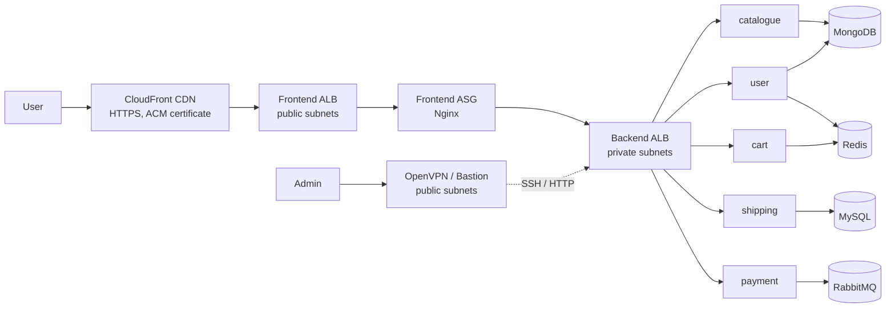

# RoboShop Infrastructure on AWS (dev)

Terraform code that builds the complete AWS environment for **RoboShop**, an e-commerce application made of 11 microservices (Node.js, Java, Python, Nginx, MongoDB, MySQL, Redis, RabbitMQ).

The environment is split into **12 small Terraform stacks** that are applied in order. Each stack has its own remote state and shares its outputs with the next stacks through **AWS SSM Parameter Store**, so no stack reads another stack's state file directly.

> Hands-on lab project, built while learning DevOps with the RoboShop training application. The infrastructure code, modules and automation are my own work.

## Architecture




- **Public subnets:** bastion host, OpenVPN server, frontend load balancer, NAT gateway
- **Private subnets:** backend load balancer and all application services, each in its own Auto Scaling Group
- **Database subnets:** MongoDB, MySQL, Redis and RabbitMQ
- Admin access only through the bastion host or the VPN. The databases have no public access.

## Stacks

Apply the folders in this order. Each folder is an independent Terraform root module.

| Order | Folder | What it creates |
|---|---|---|
| 1 | `00-vpc` | VPC with public, private and database subnets across 2 AZs, NAT gateway, route tables and peering to the default VPC, using my [terraform-aws-vpc](https://github.com/prudhvisaikoppaka/terraform-aws-vpc) module |
| 2 | `10-sg` | 14 security groups and 50 least-privilege rules between them, using my [terraform-aws-securitygroup](https://github.com/prudhvisaikoppaka/terraform-aws-securitygroup) module |
| 3 | `20-bastion` | Bastion host in a public subnet |
| 4 | `30-vpn` | Self-hosted OpenVPN Access Server with its own key pair and Route 53 record |
| 5 | `40-databases` | MongoDB, MySQL, Redis and RabbitMQ servers with Route 53 records, configured by Ansible |
| 6 | `50-backend-alb` | Internal Application Load Balancer for the backend services |
| 7 | `60-acm` | ACM certificate with DNS validation in Route 53 |
| 8 | `60-catalogue` | Catalogue service (first version of the service pattern, before it was turned into a module) |
| 9 | `70-frontend-alb` | Public Application Load Balancer with an HTTPS listener |
| 10 | `80-user` | User service, using my [terraform-aws-roboshop](https://github.com/prudhvisaikoppaka/terraform-aws-roboshop) module |
| 11 | `90-components` | All application services (catalogue, user, cart, shipping, payment, frontend) created with `for_each` over the same module |
| 12 | `91-cdn` | CloudFront distribution in front of the frontend, HTTPS only (TLS 1.2+), caching enabled for `/media/*` and disabled for dynamic pages |

## How each service is deployed

The [terraform-aws-roboshop](https://github.com/prudhvisaikoppaka/terraform-aws-roboshop) module turns one service into a scalable deployment:

1. Launch an EC2 instance in a private subnet.
2. Configure it with **ansible-pull**, using the roles in [ansible-roboshop-roles-tf](https://github.com/prudhvisaikoppaka/ansible-roboshop-roles-tf).
3. Stop the instance and create an **AMI** from it.
4. Create a **launch template** and an **Auto Scaling Group** (1 to 10 instances, CPU target tracking at 75%, rolling instance refresh).
5. Register the group with a **target group** and add a host-based **listener rule** on the load balancer.

## Tech stack

Terraform · AWS (VPC, EC2, Auto Scaling, ALB, Route 53, ACM, CloudFront, SSM Parameter Store, S3) · Ansible · OpenVPN · Bash

## Remote state

Each stack stores its state in S3 with encryption and **native S3 state locking** (`use_lockfile = true`):

```hcl
backend "s3" {
  bucket       = "prudhvisai-remote-state-dev"
  key          = "roboshop-dev-vpc"
  region       = "us-east-1"
  encrypt      = true
  use_lockfile = true
}
```

## Usage

```bash
cd 00-vpc
terraform init
terraform plan
terraform apply
```

Repeat for each folder in the order above. Destroy in reverse order.

**Requirements:** Terraform 1.10 or later, AWS provider 6.x, AWS credentials with access to the account, and a Route 53 hosted zone for your domain.

## What I learned

- Splitting infrastructure into small stacks keeps each `apply` fast and limits the blast radius of a mistake.
- SSM Parameter Store is a simple way to share values between stacks without coupling them to each other's state.
- Baking an AMI per service and using rolling instance refresh gives zero-downtime updates without extra tooling.

## Next steps

- Replace SSH password authentication in the provisioners with key-based access and secrets from AWS Secrets Manager
- Add a GitHub Actions pipeline that runs `terraform fmt`, `validate` and `plan` on every pull request
- Move the services to Kubernetes (Amazon EKS)

## Related repositories

- [terraform-aws-vpc](https://github.com/prudhvisaikoppaka/terraform-aws-vpc): VPC module
- [terraform-aws-securitygroup](https://github.com/prudhvisaikoppaka/terraform-aws-securitygroup): security group module
- [terraform-aws-roboshop](https://github.com/prudhvisaikoppaka/terraform-aws-roboshop): service module (EC2, AMI, ASG, ALB rule)
- [ansible-roboshop-roles-tf](https://github.com/prudhvisaikoppaka/ansible-roboshop-roles-tf): Ansible roles used during provisioning
- [shell-roboshop](https://github.com/prudhvisaikoppaka/shell-roboshop): the first version of the same setup, written in Bash
- [diagrams](https://github.com/prudhvisaikoppaka/diagrams): architecture diagrams
